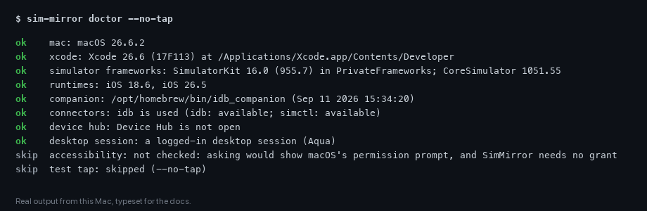

# The doctor

```sh
sim-mirror doctor
```

checks this Mac for what SimMirror needs, in the order you would fix things, and ends with a real tap. Nothing it does
installs, selects or changes anything; every problem comes with a fix.



## The checks

| Check | Looks at |
|---|---|
| `mac` | That this is a Mac; on anything else the rest are skipped |
| `xcode` | The Xcode SimMirror's programs run with -- `device.developer_dir`, else `DEVELOPER_DIR`, else `xcode-select -p` -- what named it, its version, and the Xcode the rest of the Mac uses when that is another. On a Mac with the Android SDK and no Xcode, a missing Xcode is a warning: Android devices work without it |
| `simulator frameworks` | Where `SimulatorKit.framework` is (Xcode 27 moved it to `Contents/SharedFrameworks`) and the machine's `CoreSimulator.framework` |
| `runtimes` | The iOS runtimes installed |
| `native helper` | SimMirror's own helper: which one it runs and whether it fits this SimMirror; with a booted simulator, that it reaches it -- its screen, a picture, input and the element tree -- without tapping anything |
| `companion` | idb_companion: where it is, its version, and the Xcode it starts with; not needed while the native helper works |
| `running companions` | Each companion already running, and the Xcode it runs with: a companion keeps the one it started with |
| `connectors` | Which connectors can be used here, and which one `connectors.preferred` gives -- and, with the Android SDK, which one Android devices use |
| `real devices` | While `real_devices.enabled`, the iPhones and iPads connected to this Mac, each with its iOS, how it is connected and what stands in its way -- locked, not trusted, Developer Mode off |
| `cable screen` | While `real_devices.screen` is `auto` or `usb`, that the native helper can read a cabled device's screen; macOS asks once to let sim-mirror-helper use the Camera |
| `camera` | While `real_devices.screen` is `auto` or `usb`, whether macOS lets sim-mirror-helper use the Camera, which reading a screen by cable needs -- as the helper's own log says of its latest run for each device: it read a screen, macOS withheld the Camera (with where to allow it), or what else it said went wrong, such as a locked device sending no picture. macOS itself is not asked, which would show its permission prompt |
| `webdriveragent` | While `real_devices.wda.enabled`, that this Mac can sign it -- a development certificate, or `real_devices.team_id` -- and whether it is set up for the team found outside a project (Set up touch, or `sim-mirror wda setup`) |
| `touch now` | For every real device a running daemon drives, whichever folder's project it drives it for, whether WebDriverAgent touches it now -- set up is not the same as running -- and, when not, what its session says stands in the way, such as a cable that came out, with what last kept WebDriverAgent from driving it and when |
| `recording` | That `recording.folder` can be written, and that the native helper can render recordings |
| `android sdk` | While `android.enabled`, the [Android](android.md) SDK SimMirror found, its adb and emulator, whether adb's server answers -- never starting it -- and the AVDs, with what stops one that cannot start |
| `android devices` | The emulators running and the phones adb lists, and a phone still to allow this Mac to debug it |
| `scrcpy` | While `android.scrcpy.enabled`, whether scrcpy's server is set up (Set up touch, or `sim-mirror android setup`), checked by its hash |
| `android builds` | While `build.tools`, the JDK a Gradle build would run with |
| `device hub` | Whether Xcode 27's Device Hub is running, which can swallow input |
| `desktop session` | A logged-in graphical session, which simulators need |
| `accessibility` | Reported as not checked: reading it would show macOS's permission prompt |
| `xcode tools` | Whether the Xcode in use has an `mcpbridge` SimMirror can use; when `connectors.preferred` is `mcpbridge` or `connectors.mcpbridge.merge` is on, a real read of a booted simulator's UI hierarchy, which is also where Xcode says it has not approved SimMirror |
| `app hierarchy` | Unless `connectors.app.merge` is off, whether an app on a booted simulator shares its view hierarchy through [SimMirror's debug SDK](app-sdk.md), and a real read of it: the app, its SDK version and how many views it shares. No app sharing one is fine; an app in front that does not answer, or speaks a newer protocol, is a warning |
| `screen reading` | Unless `perception.ocr` is `off`, that SimMirror's text reader compiles with the Xcode in use and reads a test picture with Vision; a warning says how to stop reading pixels. The first run compiles the reader, which takes a few seconds |
| `worktree settings` | When the folder the doctor runs in is a [git worktree](clients/claude-code-cli.md#git-worktrees) of a project, whether its scope has settings of its own; when it has none and the same folder of the main checkout has some, a warning names them and gives the `sim-mirror config copy` command that copies them. A main checkout made with `--separate-git-dir` is found only when its git folder names it back (`core.worktree`); when it does not, the check says to run `git config core.worktree "$PWD"` there. Checking writes nothing |
| `test tap` | A real tap on a simulator |

## Results

Each check is `ok`, `warn` (SimMirror works, with less -- such as view-only with neither the native helper nor idb_companion), `fail` (it does
not work until fixed) or `skip` (not checked, and why). The command exits **0** when all is well, **2** when something
only warned and **1** when something failed.

## The test tap

Everything else can look fine while touches go nowhere. So the doctor does what an agent would: it uses `--device
UDID`, else a booted simulator, else one of its own; launches Settings fresh; taps **General**; and waits for General's
page. If the screen did not change, input was swallowed, and the doctor says how to fix it -- usually Xcode 27's Device
Hub (see [Troubleshooting](troubleshooting.md#taps-do-nothing)).

`--no-tap` skips it.

## For a report

```sh
sim-mirror doctor --json
```

prints the same results as JSON. Attach it to a
[compatibility report](https://github.com/AndrewKochulab/sim-mirror/issues/new?template=compatibility-report.yml) or a
bug report.
