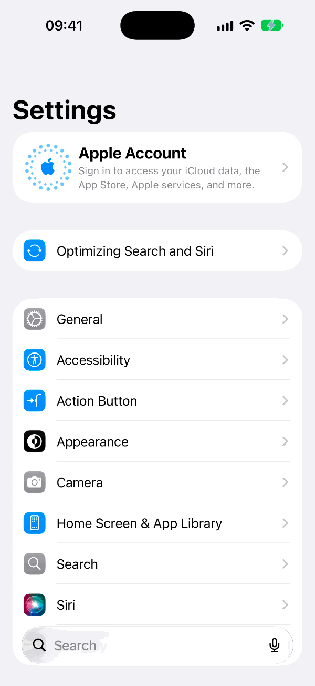

# Recording

SimMirror records a device's screen -- a simulator's or a [real device's](real-devices.md) -- as an MP4, an animated GIF
or both, with each touch drawn where it landed: the agent's and a person's. A person records from the viewer, an agent
with `sim_record`, and a terminal with `sim-mirror record`; all three record the same way and keep the files in the
same folder.



## From the viewer

The **Record** button in the toolbar starts a recording; it turns into a stop button and the bar counts the time
(`REC 1:12`). Stopping keeps it, and a note over the screen offers each file kept to save, with its pixel size and its
size: `Save MP4 · 1206×2622 · 28.6 MB`. A recording an agent started shows there too, by whom, and a person may stop
it. The button is there when the device's connector can be recorded and the page's transport can ask.

The caret beside it says how the next recording is kept, as `POST /recording`'s body asks:

- **Full size** -- as the settings say;
- **For a pull request** -- the [`pr` preset](#put-a-demo-in-a-pull-request) (`preset: "pr"`); the caret shows `PR`;
- **Both** -- full size, and [a `pr` copy beside it](#a-copy-beside-the-full-size-recording) (`also: "pr"`); the caret
  shows `+PR`, and the copy's button says so: `Save MP4 for a pull request · 450×978 · 2.5 MB`.

The choice is for the recordings this viewer starts, until the page goes, and is not changed while one is under way. A
server older than these options keeps the recording as its settings say; when Both was asked for and no copy came
back, the note says the server does not make one.

## From an agent

`sim_record` takes an `action`:

- `start` -- with `format` (`mp4`, `gif` or `both`), `touches`, `speed` (`1`, `1.5`, `2` or `4`), `status_bar`,
  `width` (240 to 1200 pixels, for the MP4 and the GIF), `quality` (the MP4's: `low`, `medium` or `high`) and `preset`
  (`pr`, [below](#put-a-demo-in-a-pull-request)), each the setting's when left out; what a call says comes before its
  preset; `also` (`pr`), a copy to keep [beside it](#a-copy-beside-the-full-size-recording); `max_seconds` (5 to
  3600), how long it may run before it stops by itself, instead of `recording.max_seconds`; and `label`, joined into
  [its file name](#what-is-kept);
- `stop` -- keeps it, and answers each file's path, size and pixel size; `also: "pr"` here keeps that copy too;
- `status` -- whether the device is being recorded, for how long and by whom, and which recordings are still being
  rendered;
- `list` -- the recordings still being rendered, then those kept, newest first.

A recording stops by itself after `recording.max_seconds` -- or the call's `max_seconds` -- and is kept. The next
`stop` still answers it: `stopped by itself at 300s, its limit; kept …`, with its files once they are rendered; its
note says so too.

### Long recordings

Rendering takes a while for a long recording: every frame is drawn, still or not. `stop` waits about a minute for it,
then answers that it is still rendering and where each file will be kept; rendering goes on, and `status` and `list`
name it until it is kept. Through HTTP, `DELETE /recording` answers the same way -- `rendering: true`, the recording
with no files yet and a note saying where they will be -- and `GET /recordings` names it under `finishing`. A render
that fails is logged and noted, and loses nothing: see [what is kept](#what-is-kept).

## From a terminal

```sh
sim-mirror record start --format gif
sim-mirror record start --preset pr          # or --width 450 --quality low
sim-mirror record start --also pr            # full size, and a pr copy beside it
sim-mirror record start --max-seconds 2400 --label "firmware update"
sim-mirror record stop
sim-mirror record list
```

for this folder's project, or `--scope` another. The daemon records; the command asks it to, and `stop` waits as
long as the daemon does for rendering.

## What is kept

A simulator is recorded by `simctl io recordVideo`; a real device from the screen SimMirror shows, which over the cable
is the live screen. SimMirror's native helper then renders it with the Mac's own frameworks -- AVFoundation,
VideoToolbox and ImageIO, no ffmpeg:

- **MP4**, H.264 or HEVC (`recording.codec`), sped up when asked, without sound: at the screen's own size, or
  `recording.mp4_width` wide, and at the bitrate `recording.mp4_quality` gives that size -- `high` may spend 4 bits a
  second on each pixel, `medium` 1 and `low` 0.3, so a smaller movie is smaller in proportion, and a still screen
  costs less. Both sides are kept even, as H.264 needs;
- **GIF**, `recording.gif_width` wide at `recording.gif_fps`, with frames that do not change merged;
- **as long as it ran**: both run for the time the recording did, by the clock, the last picture held to the end -- a
  screen that stood still for a minute shows still for that minute, sped up when asked;
- **touches**: a ring where each tap landed and a trail along each swipe, unless `recording.touches` is off;
- **a demo status bar** -- 9:41, full signal and battery -- while recording, where the device can take one
  (`recording.status_bar`); its own status bar comes back after. A real device's cable screen already shows 9:41.

A simulator's recording that the helper cannot render is kept as recorded, without its touches, and says so; a real
device's needs the helper. A recording that cannot be rendered at all is never lost: its raw recording is kept beside
the others, as `<id>.raw` (SimMirror's frame file) or `<id>.raw.mp4` (a simulator's movie), and its note -- which `list`
shows -- and the answer say why and where.

A file is rendered under a hidden name, `.<id>.partial.mp4`, and takes its own name only once it is finished, so a file
with a recording's name always plays; one that could not be finished is removed. The note beside it is written whole. Measured (2026-09-29): 10.8 seconds of an iPhone 14 Pro over its cable kept as a 900×1952
MP4 of 4.3 MB and a 600-pixel GIF of 2.0 MB.

Files are named for when they began, in your time, and the device: `20260929-034515-andrew-s-iphone.mp4`. A `label`
follows the device's name, made of lower-case letters, digits and dashes and at most 40 characters:
`label: "Unlock flow"` keeps `20260929-034515-andrew-s-iphone-unlock-flow.mp4`. It names a file, never a path: where
recordings are kept is `recording.folder`'s alone.

## Privacy

A recording shows whatever was on the screen. They are kept in `recording.folder` -- SimMirror in your Movies folder
when it is empty -- which only you can open (0700), each file readable only by you (0600). The oldest go once there are
more than `recording.keep`. `recording.folder` is [sensitive](settings.md#sensitive-settings): a page cannot move it
without a code from the terminal. The viewer's download reads a file only by its name, and only from that folder.

## Put a demo in a pull request

1. Record the flow: `sim_record` `start` with `preset: "pr"` (or `sim-mirror record start --preset pr`, or the
   viewer's Record set to For a pull request), the steps, `stop`. The preset keeps an MP4 450 pixels wide, H.264 -- which every browser plays -- at `low` quality, without
   sound; what the call says besides comes first, so `preset: "pr", width: 600` is the preset at 600 wide. `speed: "2"`
   halves its size again. `stop` answers its size. For a GIF instead, `format: "gif"`.
2. **A GIF of 3 MB or less** can be committed beside the docs that show it (`docs/media/`) and linked from the pull
   request.
3. **Anything else** has to be uploaded into GitHub's comment box, which `gh` cannot do: open the pull request in a
   browser and drag the file into its description or a comment -- an agent with a browser tool can use its file upload
   -- then save. GitHub keeps an image up to 10 MB inline, and a video up to 10 MB on its free plan. `sim_record stop`
   says when a file is over that, and how to make the next one smaller: the `pr` preset, a faster `speed`, a smaller
   `recording.gif_width`, or the MP4 instead of a GIF.

### A copy beside the full-size recording

To keep the recording at full size for yourself and a small one for the pull request, give `also: "pr"` -- on
`start`, so whatever stops the recording keeps the copy, or on `stop` -- or `sim-mirror record start --also pr`, or the viewer's Record set to Both. Both
come from the same recording, with the same touches and speed: the files the call and the settings ask for, and
`<id>.pr.mp4` beside them, as the `pr` preset makes it. `stop` lists both and says which is the copy. A full-size MP4
over 10 MB is not told to be smaller when its copy is there, since the copy is the one for the pull request. A
recording kept as `pr` already gets no copy of itself, and one the native helper could not render -- a simulator's
movie kept as recorded -- gets none either; the answer says so.

Measured (2026-10-16) on a 102-second recording of an iPhone 17 Pro simulator, 1206×2622: full size at `high` 28.6 MB;
the `pr` preset 2.5 MB at speed 1 and 1.2 MB at speed 2, its text still legible. A 2.5-minute walkthrough of a real
iPhone at full size and speed 1 came to 18 MB.

These are historical file-size examples, not a 2.4.0 recording benchmark. The 2.4 recording-duration and rendering
fixes can change the output for still screens; the [latest tool measurements](performance.md) do not measure recording.

## Settings

The settings panel's **Recording** tab: `recording.folder`, `format`, `codec`, `mp4_width`, `mp4_quality`,
`max_seconds`, `touches`, `speed`, `gif_fps`, `gif_width`, `status_bar` and `keep`. See the [configuration reference](reference/configuration.md).
